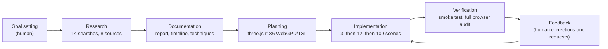
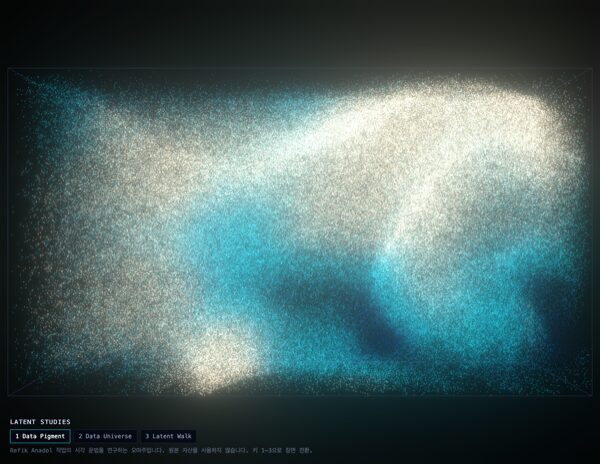
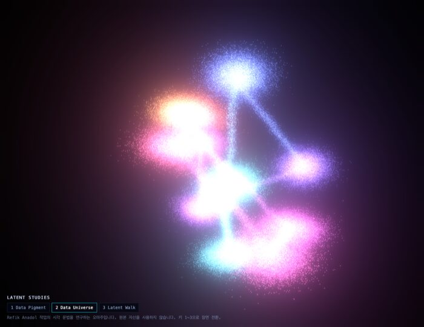
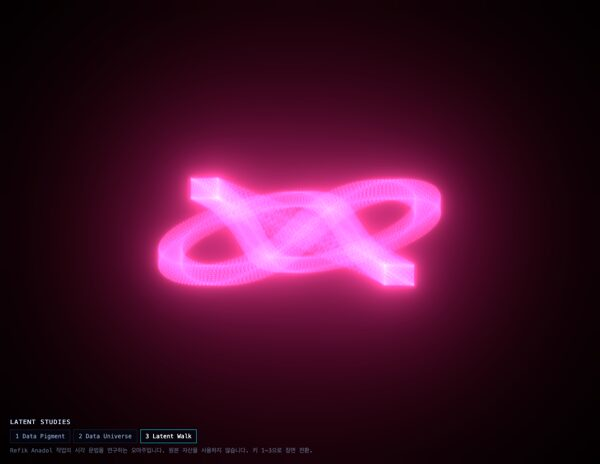
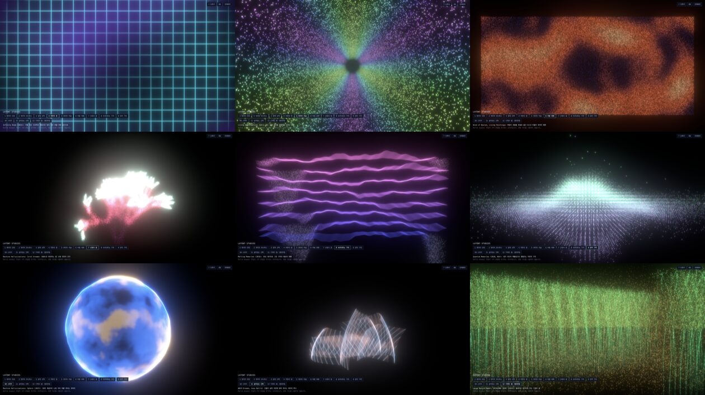

# Pigment Atlas

[한국어](README.md) | **English**

**[Open the live demo](https://epicsagas.github.io/pigment-atlas/)** (a WebGPU-capable browser is recommended)

A three.js collection that paints 100 phenomena, from the microscopic to the cosmic, using data as pigment. It was made as an homage that studies the visual grammar of media artist Refik Anadol, alongside a research archive on his work. None of the artist's original assets are used.

> [!IMPORTANT]
> The research documents and code in this repository were researched and written by AI (Claude Opus 5.5). If anything is factually wrong, awkward, or incorrectly phrased, please [open an issue](https://github.com/epicsagas/pigment-atlas/issues). Including the document name, the sentence in question, and a supporting source link helps us fix it quickly.

## How it was made: working with Claude Opus 5.5

This project is the result of a single Claude Code session with **Claude Opus 5.5** (`claude-opus-5-5`) on October 15, 2026, running from 12:57 to 18:25, about five and a half hours. That span includes idle time spent waiting for the human's next instruction. The longest gap was 87 minutes (14:21 to 15:48), and there were four more gaps of 15 to 28 minutes. The model's actual working time is therefore estimated at roughly three to four hours, based on file modification and commit timestamps.

The human set the goals and direction and reviewed the results; the model did the research, design, implementation, and verification.



1. **Research:** 14 web searches and 8 full-text extractions via Tavily. From these the model wrote a report, a timeline, a technique analysis, a catalog of works (JSON, CSV), and a source list, then exported them to HTML, DOCX, EPUB, PDF, and PPTX. Figures that disagree between sources are recorded separately.
2. **Design:** The model read the installed three.js 0.186.1 source to rule out deprecated APIs: `RenderPipeline` instead of `PostProcessing`, `Timer` instead of `Clock`, and `await renderer.init()` instead of `renderAsync()`.
3. **Implementation:** The collection grew from 3 scenes to 12. At the human's request, a catalog of 100 non-overlapping concepts was then fixed before any further code. New scenes use the declarative `defineScene()` spec. The main session wrote 15 scenes (the original 12 plus 3 new ones in the Machine Dreams theme). The remaining 85 were written in parallel by five sub-agents (the same Opus 5.5 model), one per pair of themes.
4. **Verification:** Every scene passes a GPU-free smoke test that builds its node graph, and the build passes. The smoke test also detects NaN constants and updates each scene at several points in time. Scenes were checked in a dedicated headless Chrome so the user's own browser was never touched.
5. **Physics review:** The human pointed out that chimney smoke started in mid-air with no chimney. All 100 scenes were then reviewed against real-world physics, and 42 were fixed. The human next noticed that the black hole lacked its spherical body. This led to a full browser audit that captured each scene at three moments (2, 6, and 12 seconds) and checked it by eye, fixing 21 more scenes. The main problems were solid bodies rendered see-through, objects floating without a source, and unrealistic layouts. Each review was split across five sub-agents by theme, and the main session re-captured every fixed scene to confirm.
6. **Human requests and decisions:** The human requested or decided these during the conversation: expanding the scene count, the Korean/English toggle, fullscreen, keyboard shortcuts, hideable menus, button placement, the project name, the corrections where scenes departed from reality (such as the chimney and the black hole), and the repository's visibility.

All code and documents were generated by AI and must be reviewed by a human before publication or deployment.

## Document index

| # | Document | 한국어 | English |
| --- | --- | --- | --- |
| 1 | In-depth research report | [한국어](docs/01-research-report.md) | [English](docs/en/01-research-report.md) |
| 2 | Timeline, evolution of techniques, exhibition Gantt chart | [한국어](docs/02-timeline.md) | [English](docs/en/02-timeline.md) |
| 3 | Technique breakdown and web equivalents | [한국어](docs/03-technique-analysis.md) | [English](docs/en/03-technique-analysis.md) |
| 4 | Presentation script (slides) | [한국어](docs/04-presentation.md) | [English](docs/en/04-presentation.md) |
| 5 | three.js implementation plan and audit logs | [한국어](docs/05-threejs-plan.md) | [English](docs/en/05-threejs-plan.md) |
| 6 | Catalog of the 100 scenes | [한국어](docs/06-scene-catalog.md) | [English](docs/en/06-scene-catalog.md) |
| 7 | Source list and conflicts between sources | [한국어](docs/sources.md) | [English](docs/en/sources.md) |

| Other | Location |
| --- | --- |
| Catalog of works (26 entries) | [`data/works.json`](data/works.json), [`data/works.csv`](data/works.csv) |
| Exports (HTML, DOCX, EPUB, PDF, PPTX) | Korean [`exports/`](exports), English [`exports/en/`](exports/en) |
| Screenshots | [`docs/assets/`](docs/assets) |

Regenerate the exports with:

```bash
./scripts/export-docs.sh
```

## Running Pigment Atlas (three.js)

```bash
npm install
npm run dev
```

Open `http://localhost:5173`. A WebGPU-capable browser is recommended; otherwise it falls back to WebGL2 automatically. There are **10 themes × 10 scenes = 100 scenes**, and `docs/en/06-scene-catalog.md` keeps the concepts from overlapping.

| Theme | Numbers | Examples |
| --- | --- | --- |
| 1 Machine Dreams | 1-10 | Data Pigment, Neural Network, Attention Map, Gradient Descent |
| 2 Atmosphere | 11-20 | Aurora, Lightning, Tornado, Jet Stream |
| 3 Ocean & Water | 21-30 | Ocean Swell, Jellyfish, Iceberg, Hydrothermal Vent |
| 4 Forest & Life | 31-40 | Tree Growth, Mycelium, Beehive, Ant Trails |
| 5 Earth & Geology | 41-50 | Volcano, Tectonic Drift, Canyon Strata, Geyser |
| 6 Cosmos | 51-60 | Black Hole, Supernova, Pulsar, Orrery |
| 7 Micro | 61-70 | Atomic Orbitals, DNA Helix, Mitosis, Snowflake |
| 8 City | 71-80 | Highway Trails, Metro Network, Suspension Bridge, Radio Signals |
| 9 Countryside | 81-90 | Rice Terraces, Wind Turbines, Sunflower Field, Waterwheel |
| 10 Physics & Math | 91-100 | Lorenz Attractor, Chladni Plate, Mandelbrot Set, Prism Dispersion |

The buttons at the top right open the GitHub repository, the scene index and shortcut help, switch between Korean and English (saved in localStorage), toggle fullscreen, and hide the menu.

Two URL options are available. A number in the hash such as `#42` starts at that scene, and `?webgl` forces the WebGL2 backend even in WebGPU-capable browsers (for fallback testing). Example: `https://epicsagas.github.io/pigment-atlas/?webgl#52`

On phones and tablets, buttons at the bottom (previous, next, pause, auto tour, reset camera) replace the shortcuts. Swipe the theme and scene rows sideways, and tap the screen once to bring hidden menus back. Browsers without fullscreen support (iPhone Safari) do not show the fullscreen button.

### Keyboard shortcuts

| Key | Action |
| --- | --- |
| Digits | Jump to a scene number (e.g. 4 then 2 for #42; Enter jumps immediately) |
| ← → | Previous / next scene (wraps around) |
| ↑ ↓ | Previous / next theme |
| G | Scene index |
| F | Fullscreen; Esc to exit |
| L | Korean / English |
| Space | Pause |
| A | Auto tour (30 seconds per scene) |
| R | Reset camera |
| H | Hide / show menus (also the top-right button; the choice is remembered). All shortcuts keep working while hidden, and the scene title appears briefly when the scene changes |
| ? | Shortcut help |

### Adding scenes

Write a scene as a declarative spec with `src/lib/defineScene.js` and add it to the array in `src/scenes/themes/<theme>.js`. Verify with:

```bash
node scripts/smoke.mjs        # builds every scene's node graph (no GPU needed)
npx --no-install vite build
```






Contact sheets per theme: `docs/assets/theme-01.jpg` to `docs/assets/theme-10.jpg`

### Deployment

Pushing to `main` triggers GitHub Actions (`.github/workflows/pages.yml`), which runs the smoke test, builds with `--base=/pigment-atlas/` and publishes to GitHub Pages.

See `docs/en/05-threejs-plan.md` for implementation progress and remaining steps.

## License

| Scope | License |
| --- | --- |
| Code (`src/`, `scripts/`, `index.html`, config files) | [MIT](LICENSE) |
| Documents, data, images and exports (`docs/`, `data/`, `exports/`, READMEs) | [CC BY 4.0](LICENSE-CC-BY-4.0) |

- Third-party text, work titles and figures quoted in the documents remain subject to the rights of their sources, listed in [`docs/en/sources.md`](docs/en/sources.md).
- This is an independent technique study and homage, not affiliated with Refik Anadol, Refik Anadol Studio or DATALAND.
