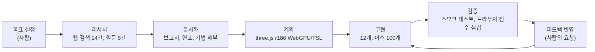

# Pigment Atlas

데이터를 안료로 삼아 미시 세계부터 우주까지 100개 현상을 그리는 three.js 작품집입니다. 미디어 아티스트 Refik Anadol의 작업을 심층 조사한 리서치 아카이브와 함께, 그 시각 문법을 연구하는 오마주로 만들었으며 작가의 원본 자산은 사용하지 않습니다.

## 만든 방식: Claude Opus 5.5와의 협업

이 프로젝트는 2026년 10월 15일, Claude Code에서 **Claude Opus 5.5**(`claude-opus-5-5`)와 하루 동안 진행한 한 세션의 결과물입니다. 사람은 목표와 방향을 정하고 결과를 검토했으며, 조사, 설계, 구현, 검증은 모델이 맡았습니다.



1. **리서치:** Tavily로 웹 검색 14건과 원문 추출 8건을 했습니다. 이를 바탕으로 보고서, 연표, 기법 해부, 작품 카탈로그(JSON, CSV), 출처 목록을 쓰고 HTML, DOCX, EPUB, PDF, PPTX로 변환했습니다. 출처끼리 수치가 어긋나는 항목은 따로 기록했습니다.
2. **설계:** 설치된 three.js 0.186.1 소스를 직접 확인해 deprecated API를 걸러냈습니다. `PostProcessing` 대신 `RenderPipeline`을, `Clock` 대신 `Timer`를, `renderAsync()` 대신 `await renderer.init()`을 썼습니다.
3. **구현:** 처음에는 장면 3개, 다음에는 12개로 늘렸습니다. 이후 사람의 요청에 따라 겹치지 않는 개념 100개를 카탈로그로 먼저 확정했습니다. 새 장면은 선언형 틀 `defineScene()`으로 작성했습니다. 15개(기존 12개와 기계의 꿈 주제의 신규 3개)는 메인 세션이 직접 작성했고, 나머지 85개는 주제별로 나눈 서브에이전트 5개(같은 Opus 5.5 모델)가 병렬로 작성했습니다.
4. **검증:** GPU 없이 노드 그래프를 생성해 보는 스모크 테스트(100/100)와 빌드를 통과했습니다. 이어서 테스트 전용 headless Chrome에서 100개 장면을 각각 8초씩 실행해 콘솔 오류 0건을 확인했습니다. 주제별 접촉 인화로 화면을 직접 보고, 과노출이나 구도가 어긋난 장면을 조정했습니다.
5. **사람의 요청과 결정:** 장면 수 확장, 한/영 토글, 전체화면, 단축키, 메뉴 숨기기, 버튼 위치, 프로젝트 이름은 대화 중 사람이 요청하거나 결정했습니다.

모든 코드와 문서는 AI가 생성했습니다. 공개하거나 배포하기 전에는 사람이 직접 검토해야 합니다.

## 문서

| 파일 | 형식 | 내용 |
| --- | --- | --- |
| `docs/01-research-report.md` | Markdown | 심층 리서치 보고서 |
| `docs/02-timeline.md` | Markdown + mermaid | 연표, 기법 진화, 전시 기간 간트 |
| `docs/03-technique-analysis.md` | Markdown + mermaid | 기법 해부와 웹 대응표 |
| `docs/04-presentation.md` | Markdown(슬라이드 원고) | 발표용 요약 |
| `docs/05-threejs-plan.md` | Markdown + mermaid | three.js 구현 계획 |
| `docs/06-scene-catalog.md` | Markdown | 100개 장면 카탈로그(주제, 개념, 시각화) |
| `docs/sources.md` | Markdown | 출처 목록과 출처 간 불일치 |
| `data/works.json`, `data/works.csv` | 데이터 | 작품 카탈로그 26건 |
| `exports/` | HTML, DOCX, EPUB, PDF, PPTX | 보고서와 발표 자료 변환본 |

변환본은 다음 명령으로 다시 만듭니다.

```bash
./scripts/export-docs.sh
```

## Pigment Atlas 실행 (three.js)

```bash
npm install
npm run dev
```

`http://localhost:5173`에서 실행합니다. WebGPU를 지원하는 브라우저를 권장하며, 지원하지 않으면 WebGL2로 자동 전환됩니다. 장면은 **10개 주제 × 10개 = 100개**이고, 개념이 겹치지 않도록 `docs/06-scene-catalog.md`에서 관리합니다.

| 주제 | 번호 | 예시 |
| --- | --- | --- |
| 1 기계의 꿈 | 1~10 | 데이터 안료, 신경망, 어텐션 지도, 경사 하강 |
| 2 대기와 날씨 | 11~20 | 오로라, 번개, 토네이도, 제트 기류 |
| 3 바다와 물 | 21~30 | 너울, 해파리, 빙산, 열수 분출공 |
| 4 숲과 생명 | 31~40 | 나무의 성장, 균사, 벌집, 개미 행렬 |
| 5 대지와 지질 | 41~50 | 화산, 판 구조, 협곡 지층, 간헐천 |
| 6 우주 | 51~60 | 블랙홀, 초신성, 펄서, 태양계 |
| 7 미시 세계 | 61~70 | 원자 오비탈, DNA, 세포 분열, 눈 결정 |
| 8 도시 | 71~80 | 고속도로 빛의 궤적, 지하철, 현수교, 전파 |
| 9 시골 | 81~90 | 다랑논, 풍력 발전기, 해바라기 밭, 물레방아 |
| 10 물리와 수학 | 91~100 | 로렌츠 끌개, 클라드니 도형, 망델브로 집합, 프리즘 |

우측 상단 버튼으로 전체 목록, 단축키 도움말, 한국어/English 전환(localStorage에 저장), 전체화면을 쓸 수 있습니다.

### 단축키

| 키 | 동작 |
| --- | --- |
| 숫자 | 장면 번호로 이동(예: 4 2를 누르면 42번, Enter로 즉시 이동) |
| ← → | 이전 / 다음 장면(순환) |
| ↑ ↓ | 이전 / 다음 주제 |
| G | 전체 목록 |
| F | 전체화면, Esc로 복귀 |
| L | 한국어 / English |
| Space | 일시정지 |
| A | 자동 순환(30초) |
| R | 카메라 초기화 |
| H | 메뉴 숨기기 / 보이기(우측 상단 버튼도 가능, 상태 기억). 숨긴 상태에서도 모든 단축키가 동작하고, 장면을 바꾸면 제목이 잠깐 표시됨 |
| ? | 단축키 도움말 |

### 장면 추가 방법

장면은 `src/lib/defineScene.js`의 선언형 사양으로 작성하고 `src/scenes/themes/<주제>.js` 배열에 넣습니다. 검증은 다음 두 명령으로 합니다.

```bash
node scripts/smoke.mjs        # 100개 장면의 노드 그래프 생성 검사(GPU 불필요)
npx --no-install vite build
```


주제별 접촉 인화: `docs/assets/theme-01.png` ~ `docs/assets/theme-10.png`

구현 진행 상황과 남은 단계는 `docs/05-threejs-plan.md`를 참고하세요.
