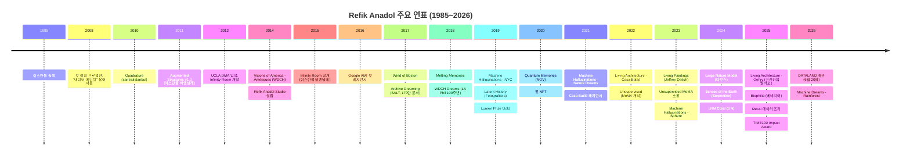
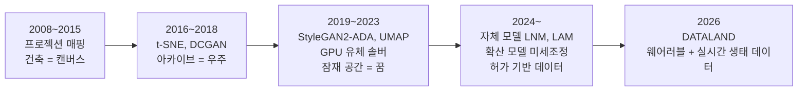
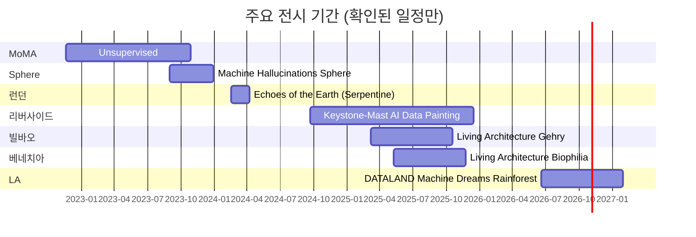

# Refik Anadol 연표

**한국어** | [English](en/02-timeline.md)

조사 기준일 2026-10-15. 구조화된 전체 목록은 `../data/works.json`, `../data/works.csv`에 있습니다.

## 전체 흐름

## 기법의 진화

## 2022~2026 주요 전시 기간

참고: Sphere 작업 기간은 Wikipedia의 "4개월 설치" 기술에 근거한 근사치입니다. 작가 사이트는 "2023-09-01부터 진행 중"으로 표기합니다.
