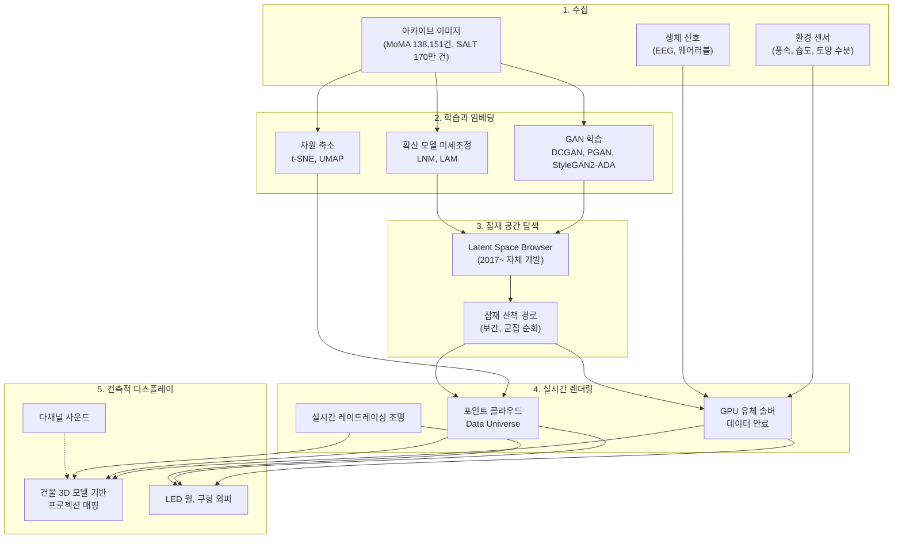

# 기법 해부: Refik Anadol의 데이터 미학 파이프라인

**한국어** | [English](en/03-technique-analysis.md)

이 문서는 공개 자료(작가 사이트의 작품 설명, 미술관 해설, 언론 기사)에 적힌 기법을 재구성한 것입니다. 스튜디오 내부 코드는 공개되지 않았으므로, "공개 기술"과 "합리적 추정"을 구분해 적었습니다.

## 1. 전체 파이프라인

## 2. 단계별 상세

### 2.1 수집: "공개 데이터"에서 "허가 기반 데이터"로

| 시기 | 데이터 정책 | 예 |
| --- | --- | --- |
| 2017~2023 | 공개 아카이브, 소셜 미디어와 검색 엔진의 공개 이미지 | Machine Hallucinations NYC(공개 사진), Unsupervised(MoMA GitHub 공개 메타데이터) |
| 2024~ | 기관 파트너십 기반 허가 데이터, LiDAR와 사진측량 현장 수집 | LNM(스미스소니언, 런던 자연사박물관, Getty, Cornell 조류연구소) |

**공개 기술**: 수집 규모(수억 장)와 출처 범주. **추정**: 중복 제거, 품질 필터링, 해상도 정규화 같은 전처리는 대규모 GAN 학습에서 표준이므로 거쳤을 것으로 봅니다.

### 2.2 학습과 임베딩

- **GAN 계열(2016~2023)**: DCGAN(Archive Dreaming), PGAN, StyleGAN, StyleGAN2-ADA(Unsupervised)를 사용했습니다. StyleGAN2-ADA는 판별자에 적응형 데이터 증강을 넣어 비교적 작은 데이터셋에서도 과적합을 줄입니다. MoMA 소장품처럼 수십만 장 이하의 큐레이션된 아카이브에 맞는 선택입니다.
- **1024차원 임베딩(Unsupervised)**: 이미지들을 고차원 벡터로 표현한 뒤 주제별로 군집화했습니다.
- **차원 축소**: t-SNE(Archive Dreaming, WDCH Dreams), UMAP(Unsupervised: Data Universe, Stockholm 아카이브 연구). 출력은 x, y, z 좌표가 되고 색(r, g, b)과 시간을 더해 "7차원" 작품이 됩니다.
- **확산 모델(2024~)**: LAM은 Gehry 건축 언어로 미세조정한 이미지 확산 모델입니다. 압축된 잠재 공간에서 생성한 뒤 자체 업스케일 모델로 16K까지 키우며, 위치와 시간대를 무작위로 바꿔 1분마다 새 이미지를 만듭니다.

### 2.3 잠재 공간 탐색

- **Latent Space Browser**: 2017년부터 개발한 자체 도구로, 학습된 잠재 공간을 탐색하며 "환각"을 고르는 인터페이스입니다. Coral Dreams 설명에 따르면 작가가 "수많은 우연한 산호 암시" 가운데 특정 환각을 직접 선택합니다. 완전 자동화가 아니라 **작가의 큐레이션이 개입하는 지점**입니다.
- **잠재 산책**: 잠재 벡터 z를 연속으로 보간하면(구면 선형 보간 slerp 같은 방식) 생성 이미지가 끊기지 않고 변형됩니다. Machine Hallucinations 특유의 "녹아내리며 다른 것이 되는" 움직임의 정체입니다.
- **에지와 밀도 채색(Unsupervised)**: 데이터 연결을 에지 검출 알고리즘으로 선으로 그리고, 직전과 다음 잠재 좌표의 밀도로 색을 칠합니다. 이동 궤적 자체가 그림이 됩니다.

### 2.4 실시간 렌더링

- **GPU 유체 솔버**: Unsupervised Fluid Dreams 설명은 "GPU 가속 유체 솔버 알고리즘과 실시간 레이트레이싱 조명"을 명시합니다. 잠재 공간에서 뽑은 색이 안료처럼 유체장에 주입되어 흐릅니다.
- **실시간 생성**: Sphere는 NVIDIA A100으로 실시간 AI 애니메이션을 만들었고, LAM과 LNM은 Google Cloud에서 상시 구동합니다.
- **추정 도구**: 협업자 포트폴리오에서 Notch(빌바오 아트 디렉션) 사용이 확인됩니다. 업계 관행상 TouchDesigner, Houdini, Unreal 계열도 쓸 수 있지만, 이번 조사에서 공식 확인은 하지 못했습니다.

### 2.5 건축적 디스플레이

- **건물 원본 3D 모델**: WDCH Dreams는 Gehry가 제공한 3D 파일로 곡면을 정확히 매핑했습니다. 프로젝터 42대, 50K 해상도, 8채널 사운드를 썼습니다.
- **트롱프뢰유 프레임**: MoMA의 24×24피트 LED 월에서 형상이 화면 가장자리를 넘어 튀어나오는 듯한 깊이 착시를 썼습니다(Saltz도 "트롱프뢰유 가장자리"라고 언급).
- **몰입형 방**: Infinity Room과 In the Mind of Gaudí는 6면 투사 큐브 룸입니다.
- **다감각 확장**: DATALAND는 200채널 사운드, 향 분사 넥밴드, 웨어러블 생체 신호로 감각의 폭을 넓혔습니다.

## 3. 웹(three.js)으로 옮길 때의 대응표

| Anadol 기법 | 웹 대응 기술 | 난이도 | 비고 |
| --- | --- | --- | --- |
| 데이터 안료 유체 | GPU 컴퓨트 입자 + 커얼 노이즈 또는 2D 유체 솔버(Stable Fluids) | 중 | WebGPU 컴퓨트 셰이더로 수십만 입자를 실시간 처리 |
| Data Universe | 사전 계산한 UMAP 좌표(JSON) + `Points` 또는 인스턴싱 | 하 | 실제 임베딩은 오프라인 Python으로 생성 |
| 잠재 산책 | 여러 목표 형상 사이의 입자 위치 보간 + 노이즈 | 중 | GAN 대신 "형상 공간"을 잠재 공간의 은유로 사용 |
| 트롱프뢰유 데이터 조각 | 고정 카메라, 박스 프레임, 깊이 안개, 블룸 | 하 | 화면 비율 고정 |
| Infinity Room | 큐브 내부 6면에 셰이더 머티리얼 | 하 | 1인칭 카메라 |
| 데이터 터널 | 카메라를 따라 재활용되는 입자 터널 | 하 | |
| 실시간 환경 데이터 | 공개 기상 API(바람) 데이터를 유체장에 주입 | 중 | API 키가 필요하면 서버 측 프록시로 처리 |
| 생체 반응 | 마이크(Web Audio), 포인터 움직임 | 하 | 개인정보를 수집하거나 저장하지 않음 |
