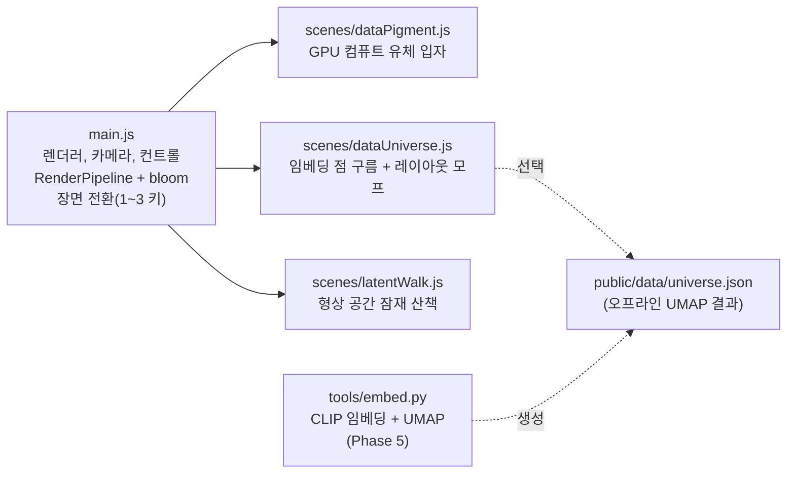

# three.js 구현 계획: Pigment Atlas (Refik Anadol 기법 연구)

## 0. 목표와 원칙

- **목표**: Anadol 작업의 시각 문법(데이터 안료, Data Universe, 잠재 산책, 데이터 조각, Infinity Room)을 브라우저에서 실시간으로 재현하는 기법 연구 작품집을 만듭니다.
- **범위 밖**: 작가의 원본 영상, 이미지, 데이터셋, 모델은 쓰지 않습니다. GAN이나 확산 모델 학습도 브라우저에서 하지 않습니다. "잠재 공간"은 사전 계산한 임베딩이나 절차적 형상 공간으로 대신합니다.
- **기술 기준**: three.js r186(`three@0.186.1`), `WebGPURenderer`와 TSL(Three Shading Language)을 씁니다. WebGPU를 지원하지 않는 브라우저에서는 같은 코드가 WebGL2 백엔드로 자동 전환됩니다.
  - 후처리는 `RenderPipeline`을 씁니다. `PostProcessing`은 r183부터 deprecated입니다.
  - 초기화는 `await renderer.init()` 후 동기 `render()`, `compute()`를 씁니다. `renderAsync()` 계열은 r181부터 deprecated입니다.
  - 입자 상태는 `instancedArray` 스토리지 버퍼와 `Fn().compute(count)` 컴퓨트 셰이더로 GPU에만 둡니다(CPU 왕복 없음).
- **빌드**: Vite 8. 의존성은 `three`와 `vite` 두 개만 씁니다.

## 1. 아키텍처



장면 모듈의 계약은 하나입니다.

```js
// 각 장면 모듈
export function create(renderer) {
  return { scene, camera?, update(dt, t) {}, dispose() {} };
}
```

## 2. 단계별 계획

| 단계 | 내용 | Anadol 참조 | 완료 기준 |
| --- | --- | --- | --- |
| P0 | Vite 스캐폴드, WebGPURenderer, OrbitControls, RenderPipeline + bloom, 장면 전환, 리사이즈 | 공통 | `vite build` 성공, 빈 장면 렌더 |
| P1 | **Data Pigment**: 26만 입자를 커얼 노이즈 유체장과 "바람" 유니폼으로 GPU에서 이류. 속도를 팔레트로 매핑(데이터 안료). 박스 프레임 안의 데이터 조각 구도 | Wind of Boston, Unsupervised Fluid Dreams, Living Paintings | 60fps 근처(M 시리즈 맥 기준), 소용돌이 흐름이 보임 |
| P2 | **Data Universe**: 합성 "아카이브" 20만 점(군집 12개)을 아카이브 그리드와 임베딩 성운 사이에서 모프. 군집별 색, 느린 궤도 카메라 | Archive Dreaming, Unsupervised: Data Universe | 두 레이아웃 사이 전환이 부드러움 |
| P3 | **Latent Walk**: 여러 절차적 형상(구, 토러스 매듭, 파동 면, 나선) 사이를 입자가 노이즈 난류를 거쳐 끝없이 보간 | Machine Hallucinations | 형상이 "녹았다가 다른 것이 되는" 순환 |
| P4 | **Infinity Room**: 1인칭 큐브 방 6면에 데이터 안료 셰이더 | Infinity Room, In the Mind of Gaudí | 방 안에서 둘러보기 가능 |
| P5 | **실데이터 파이프라인**: 공개 도메인 이미지 컬렉션으로 CLIP 임베딩 후 UMAP 3D를 JSON으로 저장하고 P2에서 불러오기 | Unsupervised(1024차원 임베딩, UMAP) | 실제 군집 구조가 보임 |
| P6 | **실시간 환경 데이터**: 공개 기상 API 풍향과 풍속을 P1 바람 유니폼에 주입. Web Audio 마이크 반응(선택, 저장 안 함) | Sphere 바람 센서, DATALAND 반응형 | 데이터 변화가 흐름에 반영 |
| P7 | 다듬기: 사운드, 장면 전환 크로스페이드, 성능 적응(입자 수 자동 조절), 전시 모드(UI 숨김, 자동 순환) | 전시 운영 | 30분 무인 순환 안정 |

이번 세션 착수 범위는 **P0~P3**이었고, 사용자 요청으로 장면 12개와 UI(한/영, 전체화면, 단축키)까지 확장했습니다.

### 진행 상황 (2026-10-15)

| 단계 | 상태 | 검증 |
| --- | --- | --- |
| P0 | 완료 | `vite build` 성공. Chrome(WebGPU)에서 콘솔 오류 0건 |
| P1 Data Pigment | 완료 | 소용돌이 흐름과 속도별 안료색 확인(`docs/assets/data-pigment.png`) |
| P2 Data Universe | 완료 | 격자에서 군집 성운으로 바뀌는 모프 확인(`docs/assets/data-universe.png`) |
| P3 Latent Walk | 완료 | 구, 토러스 매듭, 파동 면 순환 확인(`docs/assets/latent-walk.png`) |
| P4 Infinity Room | 완료 | 큐브 내부 셰이더 확인 |
| 확장 장면 5~12 | 완료 | 12개 장면 모두 콘솔 오류 0건(`docs/assets/scenes-4-12.png`) |
| P7 일부 | 완료 | 한/영 토글(localStorage 저장), 전체화면 버튼과 F 키(Esc 복귀), 단축키, 자동 순환(A), 일시정지, UI 숨김 |
| P5, P6, P7 나머지 | 대기 | 실데이터 UMAP, 실시간 기상, 사운드, 장면 크로스페이드 |

구현 중 발견해 고친 문제: `Timer.reset()`은 `performance.now()` 기준으로 리셋되지만 `update()`는 rAF 타임스탬프를 받습니다. 그래서 리셋 직후 경과 시간이 음수가 되어 Latent Walk 팔레트 인덱스가 -1이 되었습니다. 타이머는 계속 흐르게 두고 장면 시작 시점을 빼는 방식으로 수정했습니다.

## 3. 핵심 기법 설계

### 3.1 Data Pigment (P1)

- 상태: `position: vec3`, `velocity: vec3`, `life: float` 스토리지 버퍼를 둡니다.
- 유체장: 3D 노이즈 `mx_noise_vec3`의 유한차분으로 구한 커얼(발산이 0이라 소용돌이처럼 보임)에 바람 벡터 유니폼을 더합니다.
- 갱신: `v = mix(v, curl(p * freq + t * drift) + wind, 1 - damping)`, `p += v * dt`. 수명이 끝나거나 경계를 벗어나면 띠 모양 방출원에서 재생성합니다.
- 색: 속도 크기를 3색 그라디언트(심해 남색, 청록, 백열)로 매핑하고 가산 블렌딩과 bloom으로 빛의 안료처럼 보이게 합니다.

### 3.2 Data Universe (P2)

- 각 점에 두 위치 `gridPos`(아카이브 서가처럼 정렬된 격자)와 `embedPos`(군집 성운)를 둡니다.
- `morph` 유니폼(0~1)과 점마다 다른 지연값으로 `mix(gridPos, embedPos, smoothstep(...))`를 계산해 파도처럼 전환합니다.
- 색은 군집 색상(hue)에 밀도 근사 밝기를 곱합니다.
- 실데이터(P5)가 있으면 `embedPos`를 JSON 좌표로 교체합니다.

### 3.3 Latent Walk (P3)

- 형상 K개의 표본 점을 스토리지 버퍼에 미리 담습니다.
- 진행값 `phase`의 정수부는 현재 형상, 소수부는 보간 비율입니다. 보간 중간에 커얼 난류 진폭을 `sin(pi * frac)`로 키워 "환각" 단계를 만듭니다.

## 4. 성능 예산

| 항목 | 목표 |
| --- | --- |
| 입자 수 | P1 262,144 / P2 200,000 / P3 131,072 (모바일은 1/4) |
| 프레임 | 데스크톱 60fps, 저사양 30fps |
| CPU-GPU 전송 | 초기 업로드 1회, 이후 유니폼만 |

## 5. 검증

- `npx --no-install vite build` 성공
- 브라우저(browser-harness)로 각 장면을 열어 콘솔 오류가 없고 캔버스가 렌더링되는지 확인
- 시각 확인: 스크린샷 비교

## 6. 위험과 대응

| 위험 | 대응 |
| --- | --- |
| WebGPU 미지원 브라우저 | WebGPURenderer의 WebGL2 자동 폴백. 컴퓨트는 WebGL2에서 transform feedback으로 동작 |
| TSL API 변경(빠른 릴리스 주기) | 버전을 `0.186.1`로 고정. 업그레이드 때 deprecated 경고 확인 |
| 저작권과 윤리 | 원본 자산을 쓰지 않음. P5는 공개 도메인이나 CC0 컬렉션만 사용 |
| 실시간 데이터 API 키 | 키가 필요한 API는 서버 측 프록시를 거치고, 클라이언트 코드에 키를 넣지 않음 |

## 7. 확장 장면 목록 (2026-10-15 추가)

| # | 모듈 | 참조 | 핵심 구현 |
| --- | --- | --- | --- |
| 4 | `infinityRoom.js` | Infinity Room | `MeshBasicNodeMaterial` BackSide, uv 격자와 거리 펄스, 노이즈 구름 |
| 5 | `dataTunnel.js` | Gehry 3장 Data Tunnel | `mod()`로 z축 순환, 원거리 페이드 |
| 6 | `windPainting.js` | Wind of Boston, Living Paintings | 스트림 함수 유한차분으로 2D 무발산 속도장, 컴퓨트 |
| 7 | `coralDreams.js` | Coral Dreams | JS 분기 성장으로 가지 선분 생성, 깊이별 색, 커얼 흔들림 |
| 8 | `meltingMemories.js` | Melting Memories | 4개 주파수 대역 사인 합성 EEG, 노이즈 영역에서 하강 |
| 9 | `quantumMemories.js` | Quantum Memories | 점마다 다른 측정 주기로 연속 위치와 `floor()` 복셀 위치 전환 |
| 10 | `sphere.js` | Sphere | 피보나치 구, `mx_fractal_noise_float` 안료와 법선 방향 융기 |
| 11 | `livingArchitecture.js` | WDCH Dreams | 매개변수 곡면 돛 7장, uv 기반 이동 줄무늬 |
| 12 | `rainforest.js` | LNM, DATALAND | 덩굴 흔들림(높이 제곱 가중), 포자 상승 `fract()` 순환 |

공통 유틸 `src/lib/points.js`는 GPU 속성 생성(`attr`), 가산 소프트 스프라이트(`makePoints`), 장면 정리(`disposeScene`)를 제공합니다.

알려진 한계: 장면 전환 때 머티리얼은 해제하지만, 스토리지 버퍼의 GPU 메모리 회수는 three.js 내부 수명 관리에 맡깁니다. 자동 순환을 장시간 돌리는 전시 환경에서는 메모리 추이를 측정해야 합니다(P7).

## 8. 100개 확장 (2026-10-15)

- 구성: 10개 주제 × 10개. 개념 목록과 중복 방지 기준은 `06-scene-catalog.md`에 있습니다.
- 구조: 새 장면 88개는 `defineScene()` 선언형 사양(점마다 CPU에서 `init()`, 위치와 색은 TSL 노드)으로 작성했습니다. 기존 12개 모듈은 그대로 주제 배열에 편입했습니다.
- UI: 주제 탭, 주제 안 장면 목록, 전체 목록 오버레이(G), 숫자 입력 점프, ↑↓ 주제 이동을 추가했습니다.
- 검증:
  - `scripts/smoke.mjs`: Node에서 100개 장면의 노드 그래프를 생성해 100/100 통과
  - 테스트 전용 headless Chrome(WebGPU)에서 장면마다 8초씩 실행해 100/100 콘솔 오류 0건
  - 주제별 접촉 인화로 화면을 검토하고, 과노출이나 구도 문제가 있던 7개(18, 26, 30, 35, 38, 98 외)를 조정
- 교훈: 사용 중인 브라우저 탭이 가려져 있으면 `Timer`가 시간을 멈추고 화면은 스크린샷 때만 갱신됩니다. 시간에 따라 자라는 장면(나무, 균사)이 빈 화면으로 보여 버그로 오인하기 쉽습니다. 자동 검증은 전용 headless 인스턴스에서 하세요.

## 9. 실세계 물리 점검 (2026-10-15)

계기: 굴뚝 연기 장면에서 굴뚝 없이 용마루보다 0.47 높은 허공에서 연기가 시작된다는 지적이 있었습니다. 같은 기준으로 100개 장면을 모두 점검했고, **42개 장면**을 고쳤습니다. 점검표는 공통입니다: 방출원 부착, 중력과 탄도, 부력 플룸, 회전 방향과 손잡이성, 바람 일관성, 비율, 광학, 순간이동 없는 재생성.

| 주제 | 수정 장면 | 대표 수정 |
| --- | --- | --- |
| 기계의 꿈, 물리와 수학 | 10, 92, 95, 100 | 경사 하강을 -∇L 적분으로, 진자 소진폭, 클라드니 모래 연속 이동, 프리즘에 Snell 법칙과 코시 분산 |
| 대기와 날씨 | 14, 15, 16, 17, 19, 20 | 토네이도 저기압성 회전, 적운 평평한 밑면, 제트 기류 서에서 동으로 |
| 바다와 물 | 23, 24, 25, 26, 27, 28, 29 | 소용돌이 각속도 ∝ 1/r², 빙산 약 90% 잠김, 열수 플룸 감속 상승 |
| 숲과 생명 | 35, 37, 38 | 철새 고도, 낙엽 바람 표류, 민들레 씨앗 침강 |
| 대지와 지질 | 41, 42, 43, 46, 47, 49 | 해양 지각 자기 줄무늬 대칭 이동, 사구 안식각, S파 그림자 지대, 물방울 자유낙하 |
| 우주 | 51, 52, 60 | 후행 나선팔, 블랙홀 렌즈 상, 케플러 제3법칙 |
| 미시 세계 | 62, 65 | 오른손 B-DNA(한 바퀴 10.5 bp), 적혈구 회전을 유속 와도에 맞춤 |
| 도시 | 74, 77, 78, 79 | 지하철 역 정차, 보행 속도와 우측통행, 불꽃 정점 폭발 |
| 시골 | 81, 83, 85, 87, 88, 89, 90 | 굴뚝 연기, 풍력 날개 시계 방향, 상사식 물레방아 |

검증: Node 스모크 테스트 100/100, `vite build` 성공. 고친 42개는 모두 headless Chrome에서 8초 실행 후 화면을 확인했고 콘솔 오류는 0건입니다.

점검 중 발견한 함정: JS 숫자와 TSL 노드를 직접 섞은 식(`1.2 - node.mul( x )`)은 오류 없이 NaN 상수가 되어, bloom을 통해 화면 전체를 검게 만듭니다(46 지진파). `scripts/smoke.mjs`가 이제 노드 그래프의 NaN 상수를 검출합니다.

## 10. 브라우저 전수 검사 (2026-10-15)

장면마다 2, 6, 12초 시점을 headless Chrome에서 촬영해 실세계와 어긋난 곳을 눈으로 확인했습니다. 주제별 에이전트 5개가 각자 전용 브라우저로 진행했습니다. 수정한 장면은 모두 다시 촬영해 확인했습니다.

| 문제 유형 | 장면 | 수정 |
| --- | --- | --- |
| 단단한 물체가 투명해 뒤가 비침 | 19 제트 기류, 35 철새, 41 화산, 48 산맥, 52 블랙홀, 54 태양 코로나, 55 행성의 고리, 64 바이러스 캡시드, 71 스피어, 72 살아있는 건축, 75 마천루 | 불투명 차폐 메시(구, 원뿔, 지형면, 박스, 파사드 면)를 표면 바로 안쪽에 넣음 |
| 근원 없이 떠 있음 | 13 번개(땅 없음), 14 토네이도(구름 없음), 90 물레방아(바퀴 받침과 수로 기둥 없음) | 땅과 섬광, 회전 벽구름, A자 받침과 가대 기둥 추가 |
| 비현실적 배치와 비율 | 34 반딧불이, 37 낙엽(격자 무늬), 60 태양계(행성 일렬), 68 세균 군집(겹침), 83 풍력 발전기(로터 겹침), 92 진자 파동(길이 15배 차이) | 해시 배치, 행성별 초기 각도, 군집 크기 제한, 엇갈린 배치, 실제 장치 비율 |
| 과노출 | 56 초신성 섬광 | 밝기 조정 |

공통 버그도 고쳤습니다. 장면을 불러온 직후 `Timer`가 경과 시간을 아주 조금 음수로 돌려주는 경우가 있어서, 주기를 배열 인덱스로 쓰는 장면에서 `MODES[-1]` 오류가 났습니다(95 클라드니). `main.js`에서 장면에 넘기는 시간과 dt를 0 이상으로 고정했고, 스모크 테스트는 이제 여러 시점(0, 1.5, 7.3, 31, 97초)에서 `update`를 호출합니다.

결과: 콘솔 오류 0건(100/100), 스모크 테스트 100/100, 빌드 성공.
