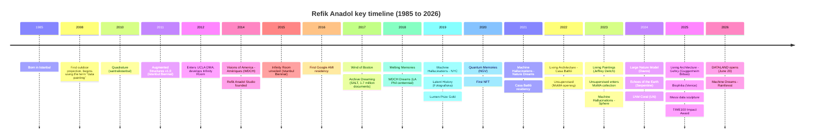
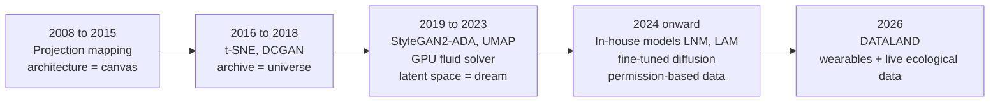
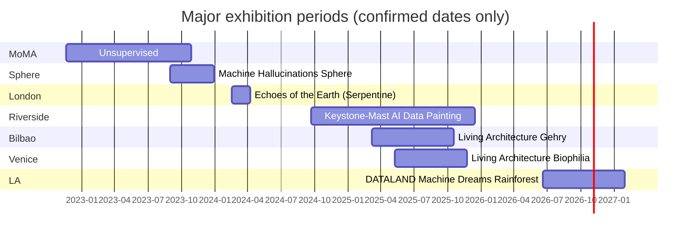

# Refik Anadol Timeline

[한국어](../02-timeline.md) | **English**

Research cutoff: 2026-10-15. The full structured list is in `../../data/works.json` and `../../data/works.csv`.

## Overview

## Evolution of technique

## Major exhibition periods, 2022 to 2026

Note: the Sphere run is an approximation based on Wikipedia's description of a "four-month installation". The artist's site lists it as "ongoing since 2023-09-01".
