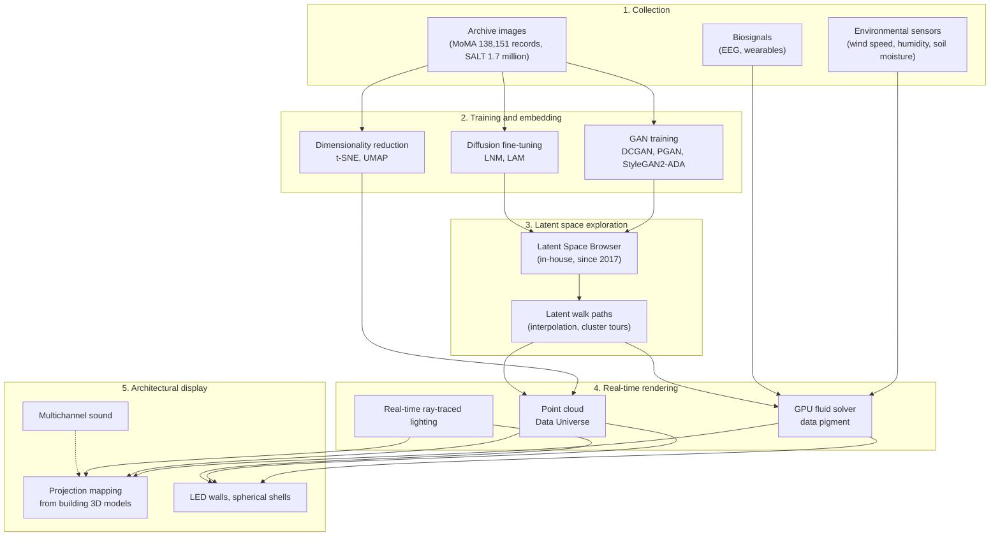

# Technique Breakdown: Refik Anadol's Data Aesthetics Pipeline

[한국어](../03-technique-analysis.md) | **English**

This document reconstructs the techniques described in public materials (work descriptions on the artist's site, museum texts, press articles). The studio's internal code is not public, so "publicly stated techniques" and "reasonable inferences" are kept separate.

## 1. Overall pipeline

## 2. Stage by stage

### 2.1 Collection: from "public data" to "permission-based data"

| Period | Data policy | Examples |
| --- | --- | --- |
| 2017 to 2023 | Public archives, public images from social media and search engines | Machine Hallucinations NYC (public photos), Unsupervised (MoMA's public metadata on GitHub) |
| 2024 onward | Permission-based data through institutional partnerships, on-site LiDAR and photogrammetry | LNM (Smithsonian, Natural History Museum London, Getty, Cornell Lab of Ornithology) |

**Publicly stated:** the scale of collection (hundreds of millions of images) and the categories of sources. **Inferred:** preprocessing such as deduplication, quality filtering and resolution normalization is standard for large-scale GAN training, so it was likely applied.

### 2.2 Training and embedding

- **GAN family (2016 to 2023):** DCGAN (Archive Dreaming), PGAN, StyleGAN, StyleGAN2-ADA (Unsupervised). StyleGAN2-ADA adds adaptive data augmentation to the discriminator, reducing overfitting even on relatively small datasets. It suits curated archives of a few hundred thousand images or fewer, such as the MoMA collection.
- **1024-dimensional embeddings (Unsupervised):** images were represented as high-dimensional vectors and then clustered by theme.
- **Dimensionality reduction:** t-SNE (Archive Dreaming, WDCH Dreams) and UMAP (Unsupervised: Data Universe, Stockholm archive studies). The output becomes x, y, z coordinates, and adding color (r, g, b) and time makes a "seven-dimensional" work.
- **Diffusion models (2024 onward):** LAM is an image diffusion model fine-tuned on Gehry's architectural language. It generates in a compressed latent space, upscales to 16K with in-house upscaling models, and makes a new image every minute while randomly changing location and time of day.

### 2.3 Latent space exploration

- **Latent Space Browser:** an in-house tool developed since 2017 for exploring a trained latent space and choosing "hallucinations". According to the Coral Dreams description, the artist personally selects particular hallucinations from "countless serendipitous allusions to coral". It is not fully automated; this is **where the artist's curation intervenes**.
- **Latent walk:** interpolating the latent vector z continuously (for example with spherical linear interpolation, slerp) makes the generated image transform without breaks. This is the source of the "melting into something else" motion characteristic of Machine Hallucinations.
- **Edge and density coloring (Unsupervised):** data connections are drawn as lines with an edge-detection algorithm and colored by the density of the previous and next latent coordinates. The path of movement itself becomes the drawing.

### 2.4 Real-time rendering

- **GPU fluid solver:** the Unsupervised Fluid Dreams description explicitly mentions "fluid solver algorithms accelerated by GPU computation and real-time ray-traced lighting". Colors drawn from the latent space are injected into a fluid field like pigment and flow.
- **Real-time generation:** Sphere produced real-time AI animation on NVIDIA A100s, and LAM and LNM run continuously on Google Cloud.
- **Inferred tools:** a collaborator's portfolio confirms Notch (Bilbao art direction). TouchDesigner, Houdini and Unreal-family tools are also plausible by industry practice, but this research could not confirm them officially.

### 2.5 Architectural display

- **Original building 3D models:** WDCH Dreams mapped the curved surfaces precisely using 3D files provided by Gehry, with 42 projectors, 50K resolution and 8-channel sound.
- **Trompe-l'œil frame:** the 24 × 24 ft LED wall at MoMA used a depth illusion in which forms seem to burst past the screen edges (Saltz also mentions the "trompe l'oeil edges").
- **Immersive rooms:** Infinity Room and In the Mind of Gaudí are cube rooms projected on all six sides.
- **Multisensory expansion:** DATALAND widened the senses with 200-channel sound, scent-diffusing neckbands and wearable biosignals.

## 3. Mapping to the web (three.js)

| Anadol technique | Web counterpart | Difficulty | Notes |
| --- | --- | --- | --- |
| Data pigment fluid | GPU compute particles + curl noise or a 2D fluid solver (Stable Fluids) | Medium | Hundreds of thousands of particles in real time with WebGPU compute shaders |
| Data Universe | Precomputed UMAP coordinates (JSON) + `Points` or instancing | Low | Real embeddings generated offline in Python |
| Latent walk | Particle position interpolation between target shapes + noise | Medium | A "shape space" stands in as a metaphor for the latent space instead of a GAN |
| Trompe-l'œil data sculpture | Fixed camera, box frame, depth fog, bloom | Low | Fixed aspect ratio |
| Infinity Room | Shader materials on the six inner faces of a cube | Low | First-person camera |
| Data tunnel | Recycled particle tunnel following the camera | Low | |
| Real-time environmental data | Inject public weather API (wind) data into the fluid field | Medium | If an API key is needed, route through a server-side proxy |
| Biometric response | Microphone (Web Audio), pointer movement | Low | No personal data is collected or stored |
