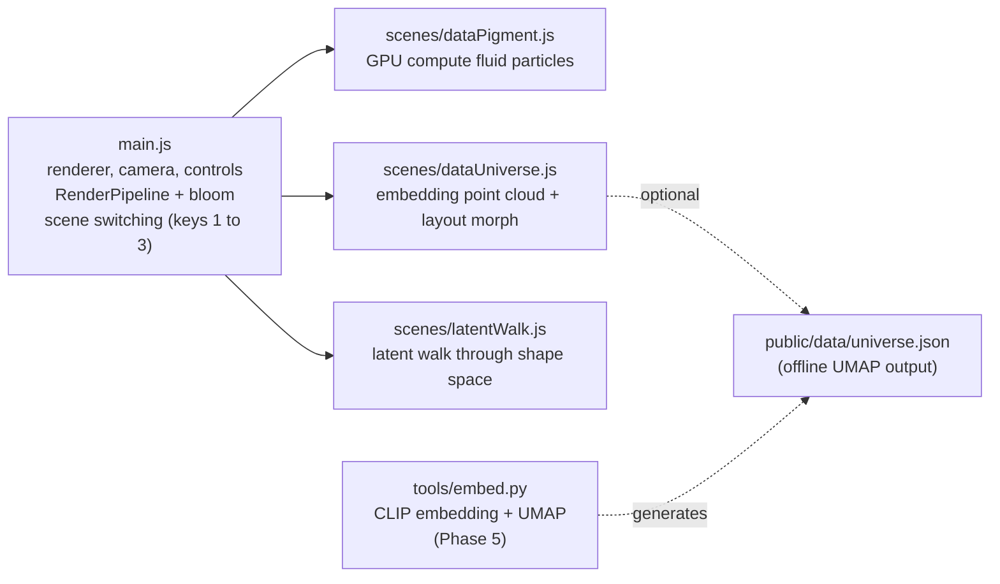

# three.js Implementation Plan: Pigment Atlas (a study of Refik Anadol's techniques)

[한국어](../05-threejs-plan.md) | **English**

## 0. Goals and principles

- **Goal**: Build a technique-study collection that reproduces the visual grammar of Anadol's work (data pigment, Data Universe, latent walk, data sculpture, Infinity Room) in real time in the browser.
- **Out of scope**: None of the artist's original videos, images, datasets, or models are used. No GAN or diffusion model is trained in the browser. The "latent space" is replaced by precomputed embeddings or a procedural shape space.
- **Technical baseline**: three.js r186 (`three@0.186.1`), `WebGPURenderer` and TSL (Three Shading Language). In browsers without WebGPU, the same code falls back to the WebGL2 backend automatically.
  - Post-processing uses `RenderPipeline`. `PostProcessing` has been deprecated since r183.
  - Initialization uses `await renderer.init()`, then synchronous `render()` and `compute()`. The `renderAsync()` family has been deprecated since r181.
  - Particle state lives only on the GPU, in `instancedArray` storage buffers updated by `Fn().compute(count)` compute shaders (no CPU round trips).
- **Build**: Vite 8. Only two dependencies: `three` and `vite`.

## 1. Architecture



Scene modules share a single contract.

```js
// Each scene module
export function create(renderer) {
  return { scene, camera?, update(dt, t) {}, dispose() {} };
}
```

## 2. Phased plan

| Phase | Contents | Anadol reference | Done when |
| --- | --- | --- | --- |
| P0 | Vite scaffold, WebGPURenderer, OrbitControls, RenderPipeline + bloom, scene switching, resize | Common | `vite build` succeeds, an empty scene renders |
| P1 | **Data Pigment**: 262k particles advected on the GPU by a curl-noise fluid field and a "wind" uniform. Speed mapped to a palette (data pigment). Composed as a data sculpture inside a box frame | Wind of Boston, Unsupervised Fluid Dreams, Living Paintings | Close to 60fps (on an M-series Mac), swirling flow visible |
| P2 | **Data Universe**: 200k points of a synthetic "archive" (12 clusters) morph between an archive grid and an embedding nebula. Per-cluster colour, slow orbiting camera | Archive Dreaming, Unsupervised: Data Universe | Smooth transition between the two layouts |
| P3 | **Latent Walk**: particles interpolate endlessly between procedural shapes (sphere, torus knot, wave sheet, spiral) through noise turbulence | Machine Hallucinations | A cycle where shapes "melt and become something else" |
| P4 | **Infinity Room**: a data-pigment shader on all six faces of a first-person cube room | Infinity Room, In the Mind of Gaudí | Can look around inside the room |
| P5 | **Real-data pipeline**: CLIP-embed a public-domain image collection, save a 3D UMAP as JSON, and load it in P2 | Unsupervised (1024-dimensional embeddings, UMAP) | A real cluster structure is visible |
| P6 | **Live environmental data**: feed wind direction and speed from a public weather API into the P1 wind uniform. Web Audio microphone response (optional, nothing stored) | Sphere wind sensors, DATALAND responsiveness | Changes in the data show up in the flow |
| P7 | Polish: sound, crossfades between scenes, performance adaptation (automatic particle count), exhibition mode (hidden UI, auto tour) | Exhibition operation | Stable unattended 30-minute loop |

The scope started in this session was **P0 to P3**; at the user's request it was extended to 12 scenes and a UI (Korean/English, fullscreen, shortcuts).

### Progress (2026-10-15)

| Phase | Status | Verification |
| --- | --- | --- |
| P0 | Done | `vite build` succeeds. 0 console errors in Chrome (WebGPU) |
| P1 Data Pigment | Done | Swirling flow and speed-based pigment colours confirmed (`../assets/data-pigment.jpg`) |
| P2 Data Universe | Done | Morph from grid to cluster nebula confirmed (`../assets/data-universe.jpg`) |
| P3 Latent Walk | Done | Sphere, torus knot, wave sheet cycle confirmed (`../assets/latent-walk.jpg`) |
| P4 Infinity Room | Done | Shader inside the cube confirmed |
| Extra scenes 5 to 12 | Done | 0 console errors in all 12 scenes (`../assets/scenes-4-12.jpg`) |
| Part of P7 | Done | Korean/English toggle (saved in localStorage), fullscreen button and F key (Esc to exit), shortcuts, auto tour (A), pause, hidden UI |
| P5, P6, rest of P7 | Pending | Real-data UMAP, live weather, sound, scene crossfades |

A problem found and fixed during implementation: `Timer.reset()` resets against `performance.now()`, but `update()` receives rAF timestamps. Right after a reset the elapsed time went negative, so the Latent Walk palette index became -1. The fix lets the timer keep running and subtracts the scene's start time instead.

## 3. Core technique design

### 3.1 Data Pigment (P1)

- State: `position: vec3`, `velocity: vec3`, `life: float` storage buffers.
- Fluid field: the curl of a 3D noise `mx_noise_vec3`, taken by finite differences (divergence-free, so it reads as swirling), plus a wind vector uniform.
- Update: `v = mix(v, curl(p * freq + t * drift) + wind, 1 - damping)`, `p += v * dt`. Particles respawn from a band-shaped emitter when their life ends or they leave the bounds.
- Colour: speed magnitude is mapped to a three-colour gradient (deep-sea navy, teal, incandescent white), and additive blending plus bloom make it look like pigment made of light.

### 3.2 Data Universe (P2)

- Each point has two positions: `gridPos` (a grid ordered like archive shelves) and `embedPos` (the cluster nebula).
- A `morph` uniform (0 to 1) and a per-point delay drive `mix(gridPos, embedPos, smoothstep(...))`, so the transition sweeps like a wave.
- Colour is the cluster hue multiplied by an approximate density brightness.
- When real data (P5) is available, `embedPos` is replaced with the JSON coordinates.

### 3.3 Latent Walk (P3)

- Sample points for K shapes are preloaded into storage buffers.
- The integer part of the progress value `phase` selects the current shape and the fractional part is the interpolation ratio. Midway through the interpolation, the curl-turbulence amplitude rises as `sin(pi * frac)`, creating the "hallucination" stage.

## 4. Performance budget

| Item | Target |
| --- | --- |
| Particle count | P1 262,144 / P2 200,000 / P3 131,072 (one quarter on mobile) |
| Frame rate | 60fps on desktop, 30fps on low-end hardware |
| CPU-GPU transfer | One initial upload, uniforms only afterwards |

## 5. Verification

- `npx --no-install vite build` succeeds
- Open each scene in a browser (browser-harness) and confirm there are no console errors and the canvas renders
- Visual check: compare screenshots

## 6. Risks and mitigations

| Risk | Mitigation |
| --- | --- |
| Browsers without WebGPU | WebGPURenderer falls back to WebGL2 automatically. Compute runs via transform feedback on WebGL2 |
| TSL API changes (fast release cycle) | Pin the version at `0.186.1`. Check deprecation warnings when upgrading |
| Copyright and ethics | No original assets are used. P5 uses only public-domain or CC0 collections |
| API keys for live data | APIs that need a key go through a server-side proxy; no keys in client code |

## 7. Extra scene list (added 2026-10-15)

| # | Module | Reference | Core implementation |
| --- | --- | --- | --- |
| 4 | `infinityRoom.js` | Infinity Room | `MeshBasicNodeMaterial` BackSide, uv grid with a distance pulse, noise clouds |
| 5 | `dataTunnel.js` | Gehry chapter III, Data Tunnel | z-axis wraparound with `mod()`, distance fade |
| 6 | `windPainting.js` | Wind of Boston, Living Paintings | 2D divergence-free velocity field from finite differences of a stream function, compute |
| 7 | `coralDreams.js` | Coral Dreams | Branch segments grown by JS branching, colour by depth, curl sway |
| 8 | `meltingMemories.js` | Melting Memories | Synthetic EEG from sines in four frequency bands, sinking inside noise regions |
| 9 | `quantumMemories.js` | Quantum Memories | Per-point measurement period switching between a continuous position and a `floor()` voxel position |
| 10 | `sphere.js` | Sphere | Fibonacci sphere, `mx_fractal_noise_float` pigment and bulging along the normal |
| 11 | `livingArchitecture.js` | WDCH Dreams | Seven parametric sail surfaces, uv-based moving stripes |
| 12 | `rainforest.js` | LNM, DATALAND | Vine sway (weighted by height squared), spores rising in a `fract()` loop |

The shared utility `src/lib/points.js` provides GPU attribute creation (`attr`), additive soft sprites (`makePoints`), and scene cleanup (`disposeScene`).

Known limitation: materials are released on scene switch, but reclaiming GPU memory for storage buffers is left to three.js's internal lifetime management. Memory trends must be measured for exhibitions that run the auto tour for long periods (P7).

## 8. Expansion to 100 scenes (2026-10-15)

- Layout: 10 themes × 10 scenes. The concept list and the rules against overlap are in `06-scene-catalog.md`.
- Structure: the 88 new scenes are written as `defineScene()` declarative specs (`init()` per point on the CPU, position and colour as TSL nodes). The existing 12 modules were folded into the theme arrays as they are.
- UI: theme tabs, a per-theme scene list, a full index overlay (G), digit-entry jumps, and theme navigation with the up and down arrow keys were added.
- Verification:
  - `scripts/smoke.mjs`: builds the node graphs of all 100 scenes in Node, 100/100 passed
  - In a dedicated headless Chrome (WebGPU), each scene ran for 8 seconds: 0 console errors, 100/100
  - Screens were reviewed on per-theme contact sheets, and 7 scenes with overexposure or framing problems (18, 26, 30, 35, 38, 98 and others) were adjusted
- Lesson: when the browser tab in use is occluded, `Timer` stops time and the screen only updates on screenshots. Scenes that grow over time (trees, mycelium) then show as blank and are easily mistaken for bugs. Run automated checks in a dedicated headless instance.

## 9. Real-world physics review (2026-10-15)

Trigger: it was pointed out that in the Chimney Smoke scene the smoke started in mid-air, 0.47 above the ridge, with no chimney. All 100 scenes were reviewed against the same standard and **42 scenes** were fixed. The checklist was shared: emitter attachment, gravity and ballistics, buoyant plumes, rotation direction and handedness, wind consistency, proportions, optics, respawning without teleporting.

| Theme | Scenes fixed | Representative fixes |
| --- | --- | --- |
| Machine Dreams, Physics & Math | 10, 92, 95, 100 | Gradient descent as integration of -∇L, small pendulum amplitude, continuous sand migration on the Chladni plate, Snell's law and Cauchy dispersion for the prism |
| Atmosphere | 14, 15, 16, 17, 19, 20 | Cyclonic tornado rotation, flat cumulus base, jet stream from west to east |
| Ocean & Water | 23, 24, 25, 26, 27, 28, 29 | Maelstrom angular speed ∝ 1/r², iceberg about 90% submerged, hydrothermal plume rising with deceleration |
| Forest & Life | 35, 37, 38 | Bird migration altitude, wind drift of falling leaves, settling of dandelion seeds |
| Earth & Geology | 41, 42, 43, 46, 47, 49 | Symmetric drift of oceanic-crust magnetic stripes, dune angle of repose, S-wave shadow zone, free-falling drips |
| Cosmos | 51, 52, 60 | Trailing spiral arms, black hole lensed image, Kepler's third law |
| Micro | 62, 65 | Right-handed B-DNA (10.5 bp per turn), red blood cell spin matched to the flow vorticity |
| City | 74, 77, 78, 79 | Metro trains stopping at stations, walking speed and right-hand traffic, fireworks bursting at apex |
| Countryside | 81, 83, 85, 87, 88, 89, 90 | Chimney smoke, wind turbine blades turning clockwise, overshot waterwheel |

Verification: Node smoke test 100/100, `vite build` succeeds. All 42 fixed scenes were run for 8 seconds in headless Chrome and checked on screen, with 0 console errors.

A pitfall found during the review: an expression that mixes JS numbers directly with TSL nodes (`1.2 - node.mul( x )`) silently becomes a NaN constant, which blacks out the whole frame through bloom (46 Seismic Waves). `scripts/smoke.mjs` now detects NaN constants in the node graph.

## 10. Full browser audit (2026-10-15)

Each scene was captured in headless Chrome at 2, 6, and 12 seconds and checked by eye for departures from the real world. Five agents, one per pair of themes, each ran their own dedicated browser. Every fixed scene was captured again to confirm.

| Problem type | Scenes | Fix |
| --- | --- | --- |
| Solid bodies see-through, showing what is behind them | 19 Jet Stream, 35 Bird Migration, 41 Volcano, 48 Mountain Range, 52 Black Hole, 54 Solar Corona, 55 Planetary Rings, 64 Virus Capsid, 71 Sphere, 72 Living Architecture, 75 Skyline Windows | Opaque occluder meshes (sphere, cone, terrain surface, boxes, facade surfaces) placed just inside the surface |
| Floating without a source | 13 Lightning (no ground), 14 Tornado (no cloud), 90 Waterwheel (no wheel supports or flume posts) | Added ground and flash glow, a rotating wall cloud, an A-frame and trestle posts |
| Unrealistic layout and proportions | 34 Fireflies, 37 Autumn Leaves (grid pattern), 60 Orrery (planets in a line), 68 Bacterial Colony (overlapping), 83 Wind Turbines (overlapping rotors), 92 Pendulum Wave (15-fold length difference) | Hash-based placement, per-planet starting angles, capped colony size, staggered layout, real apparatus proportions |
| Overexposure | 56 Supernova flash | Brightness adjusted |

A shared bug was also fixed. Right after a scene loads, `Timer` sometimes returns a very slightly negative elapsed time, which caused a `MODES[-1]` error in scenes that use the cycle as an array index (95 Chladni Plate). `main.js` now clamps the time and dt passed to scenes to zero or more, and the smoke test now calls `update` at several times (0, 1.5, 7.3, 31, 97 seconds).

Result: 0 console errors (100/100), smoke test 100/100, build succeeds.
